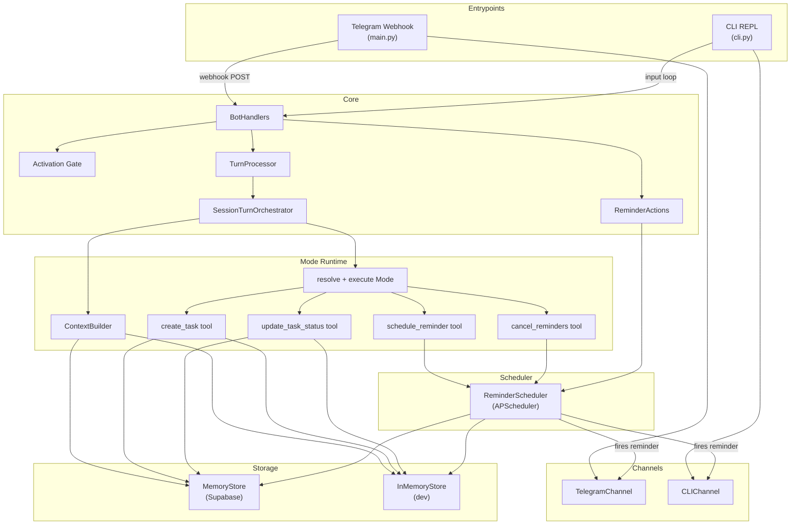

# Architecture

## Repository Structure

```
amigo/
├── src/                    # Application source code
│   ├── main.py             # FastAPI app, Telegram webhook, lifecycle
│   ├── cli.py              # CLI entrypoint for local dev (no Telegram)
│   ├── turns.py            # Session transcript + Mode execution orchestration
│   ├── conversations.py    # Channel-neutral Mode conversation resolution/lifecycle
│   ├── config.py           # Pydantic Settings from .env
│   ├── __main__.py         # python -m src.cli module entrypoint
│   ├── agent/              # Pydantic AI agent with tool-calling loop
│   │                       #   (ADR 0002: single turn, native tools)
│   ├── activation.py       # Durable dashboard-first Activation read-model rules
│   ├── startup.py          # Schema gate before scheduler/webhook side effects
│   ├── bot/                # Telegram adapter: pairing gate, turns,
│   │                       #   reminder callbacks, keyboards
│   ├── channels/           # MessageChannel protocol + implementations
│   │                       #   (Telegram, CLI)
│   ├── memory/             # Supabase store, in-memory store, sessions,
│   │                       #   context fragments
│   ├── scheduler/          # APScheduler reminder management + reload
│   ├── tools/              # Side-effect tools: create task, update status,
│   │                       #   schedule/cancel reminders
│   ├── utils/              # Clock, timezone helpers
│   └── db/                 # Supabase client singleton
├── tests/                  # Pytest test suite (all unit, no network)
│   └── fakes.py            # Shared in-memory fakes for all test modules
├── scripts/                # Utility scripts
│   └── smoke_check.py      # Production liveness checks (scheduler + channel)
├── migrations/             # Supabase SQL schema migrations
├── docs/                   # Design docs, architecture, and ADRs
│   └── adr/                # Architecture Decision Records
├── pyproject.toml          # Project metadata, dependencies, tool config
├── .env.example            # Environment variable template
└── README.md               # User-facing documentation
```

## Key Modules

- `src/agent/` — Modes, with no direct side effects. Each Mode is a declared `ModeDefinition`
  (instructions, Toolsets, Turn Context providers, entitlement, model, handoffs, evaluation suite)
  registered in `catalogue.py`. `ModeRuntime` is the one entry point that runs a Turn in any Mode:
  it resolves and authorizes the Mode before anything is written, prepends the Safety Core to any
  Mode that does not state it, runs Pydantic AI's native tool-calling loop with only that Mode's
  Toolsets (see [ADR 0002](adr/0002-agentic-tool-calling-loop.md)). Routing and entitlement are
  replaceable async policies. `admit()` in `policies.py` is the one admission check (live,
  entitled, entry guard), shared by Turns, `GET /api/modes` and Coach buttons. Daily and Coach
  are live; Reflect and Recommender are planned and refused.
- `src/turns.py` — Application boundary around `ModeRuntime`. `SessionTurnOrchestrator` resolves
  the Mode before any write, loads and persists Session Messages, and maps model failures to the
  friendly participant reply. The model framework remains behind the runtime's owned result and
  history types; this layer does not import it.
- `src/bot/` — channel-neutral glue, one `BotHandlers` per channel. It resolves senders by channel
  identity. It routes Pairing (a Telegram deep link or a typed `/pair <code>`) first, permits
  Reminder callbacks needed by the Activation test, and requires canonical Activation completion
  before ordinary text reaches Turn processing. Legacy Telegram-only onboarding is unreachable.
- `src/channels/` — `MessageChannel`, immutable `ConversationRef` addresses, and explicit
  capability declarations. Telegram owns topic IDs, Bot API decoding, private-chat deep links,
  and the defensive unavailable-thread branch. Discord (opt-in, full-access accounts) owns the
  gateway, DMs and component buttons. Discord and CLI declare no threads and use in-chat Mode
  commands. `ChannelRegistry` lists the channels a process runs and sends proactive
  messages to the participant's primary one. Application code passes opaque conversation
  references rather than provider thread IDs.
- `src/conversations.py` — `ModeConversationService` resolves or creates a Mode's channel
  conversation and closes unavailable specialized conversations. Unknown incoming conversations
  become additional Daily aliases; the model does not choose provider endpoints. A Mode can have
  several incoming conversations, rather than assuming one topic per Mode.
- `src/memory/` — `MemoryStore` (Supabase CRUD), `InMemoryStore`
  (dict-backed dev replacement), `SessionManager`, `ContextBuilder`. Production Store and Auth
  paths use Supabase's native asynchronous client; each Store operation emits content-free
  outcome and duration evidence for staging/load analysis. A runtime monitor separately samples
  event-loop scheduling delay.
- `src/scheduler/` — `ReminderScheduler` treats database Reminders as authority and APScheduler as
  a rebuildable projection. Stable jobs, durable outbox effects, startup/periodic reconciliation,
  bounded poison retries, inverse-drift removal, and the 15-minute late policy converge after
  restart or scheduler failure. Each delivery uses an atomic claim and immutable attempt outcome;
  reconciliation records a scheduler heartbeat and content-free drift counts. Later uses the
  shared immutable replacement command.
- `src/tools/` — Every side effect. `toolsets.py` groups the model-callable Tools into reusable
  `TASKS` and `REMINDERS` Toolsets; `ToolContext` carries the per-Turn dependencies they receive.
  The Tool classes (`CreateTaskTool`, `UpdateTaskStatusTool`, `ScheduleReminderTool`,
  `CancelRemindersTool`) also serve the `ReminderActions` button callbacks.

## Patterns

- **Protocol-based abstraction**: `MessageChannel` is a `typing.Protocol`
  class. Implementations are swappable without touching consumer code.
- **Dependency injection**: Per-Turn state flows through the `ToolContext`
  dataclass. Major classes accept dependencies in `__init__`.
- **Async everywhere**: All store, channel, and agent methods are
  `async def`. Supabase network operations use its native `AsyncClient` and are explicitly
  awaited, so concurrent Turns and due Reminders yield to the event loop. Constructors and
  dataclass validation remain synchronous Python protocols; `ModeRegistry.__getitem__` and
  `__iter__` are the deliberate synchronous magic-method exceptions used by import-time catalogue
  construction and synchronous Gate A schema capture. All ordinary Mode policy, registry,
  runtime, and Turn-orchestrator methods are asynchronous.
- **Fail-closed startup**: The Supabase Store must report the exact application schema version
  (currently 21) before the scheduler, durable-outbox drain, Reminder reload, or Telegram webhook
  starts.
- **Mode authority and addressing**: migrations 015–017 order crossed Pairing locks and add
  Session-active-Mode, trial-grant, immutable grant-event, confirmed-handoff, and channel-neutral
  conversation primitives. `mode_conversations` binds an owned Mode to a channel's opaque JSON
  endpoint; linked endpoint IDs are not participant identity. Sessions and history are scoped by
  `(user_id, mode_id)`. Confirmed handoffs use leased execution claims with stable replay keys;
  confirmation and execution are separate durable transitions. `HandoffController.recover` is
  the one recovery path for the server and the CLI; it rechecks owner, endpoint and activation
  inside the participant's Turn lock.
- **Capability-based routing**: threaded channels map incoming conversations to Modes; unknown
  addresses map to Daily. Non-threaded channels use `/mode` and `/daily`, and Telegram retains
  these commands for older clients. Both paths use the same Mode/entitlement resolver. An expired
  grant or withdrawn Mode is refused in its conversation instead of silently executing Daily.
- **Explicit threaded delivery**: Telegram supports production in-chat Mode commands when topics
  are off. With Threaded Mode enabled, user-created threads must be disabled. Each outgoing message carries a conversation; a deleted private
  topic may be restored by Telegram on send. Reminders resolve the participant's primary channel
  and Daily address at delivery time, keeping provider endpoints out of durable outbox payloads.
  The current implementation supports Telegram and local CLI, not a new primary-channel switcher.
- **Canonical Activation**: Normal dashboard APIs and Telegram Turns remain locked until durable
  acknowledgement, Pairing, validated profile, actual test-Reminder delivery, and Telegram
  Done/Skip/Later evidence produce a completed Activation state. The dashboard snapshot embeds
  that same state.
- **UTC internally, user-tz at boundaries**: Database instants use timezone-aware PostgreSQL
  `TIMESTAMPTZ` values normalized to UTC. Conversion to a participant's timezone happens only at
  display and planning boundaries via `src/utils/`.
- **Agentic tool calling**: The LLM decides which tools to call based on
  function signatures and docstrings. No more manual classify → extract →
  resolve pipeline. See [ADR 0002](adr/0002-agentic-tool-calling-loop.md).
- **Claimed Telegram updates**: Every supported Telegram `update_id` is atomically claimed before
  handler execution. Duplicate deliveries receive a safe acknowledgement, terminal failure codes
  remain inspectable without message content, and Turns use the stable update ID for command
  replay keys. A participant-scoped lock preserves Turn order within the single beta web process.
- **Atomic dashboard read model**: `GET /api/dashboard/snapshot` resolves the authenticated
  participant and returns one service-role-only transactional snapshot. Today, Inbox, Carried
  over, progress, joined Reminders, and normalized Sessions share one version and Planning Day;
  realtime events are invalidation hints that replace the complete browser snapshot.
- **Reliability evidence**: migration 011 records immutable Reminder occurrences and provider
  attempts without message content. `/health` proves process liveness; `/ready` separately checks
  database access, the scheduler heartbeat, and failed durable effects. Participant, staging
  synthetic, and production synthetic observations remain distinct.
- **Typed deterministic time resolution**: `src/time_resolution.py` resolves an expression into
  its local date, wall time, IANA timezone, UTC instant, confidence, and clarification or
  confirmation requirement. Bare hours, fuzzy periods, invalid DST wall times, and passed times
  are blocked before persistence; repeated DST hours default to the earlier occurrence.

## Data Flow (message lifecycle)



1. **Inbound**: Telegram webhook (or CLI input) delivers text + chat_id.
2. **Routing**: `BotHandlers` checks allowlist → linked identity → canonical Activation
   completion before delegating ordinary text to `TurnProcessor`. Pairing and Reminder callbacks
   retain their dedicated pre-Activation paths.
3. **Turn processing**: `TurnProcessor` builds a `ToolContext` (user, session, timezone) and hands
   the Turn to `SessionTurnOrchestrator`.
4. **Mode**: the orchestrator resolves the Mode before any transcript write, persists the user
   Message, and supplies bounded Session history to `ModeRuntime`. The runtime sends the Mode's
   instructions and Turn Context on every model request and runs the model with only that Mode's
   Toolsets. The orchestrator persists the resulting assistant Message, including the friendly
   failure reply when model execution fails.
5. **Outbound**: Response sent via `MessageChannel.send_message()`.
6. **Reminders**: Reminder tools resolve a typed full instant before invoking the shared durable
   schedule command. Relative expressions can schedule directly; interpretations requiring
   confirmation are persisted only when the participant returns the exact local date, wall time,
   and timezone label. The outbox drives APScheduler. Fired reminders expose Done/Skip/Later
   actions through `ReminderActions`; Later creates an immutable replacement Reminder.

## Key Abstractions

| Abstraction | Location | Purpose |
|-------------|----------|---------|
| `MessageChannel` | `channels/base.py` | Capability-based delivery and conversation lifecycle (Telegram, CLI) |
| `ConversationRef` | `channels/base.py` | Immutable channel plus opaque endpoint |
| `ModeConversationService` | `conversations.py` | Owned Mode/address resolution and grant-expiry maintenance |
| `ToolContext` | `tools/context.py` | Per-Turn dependency injection for Tools |
| Store (duck-typed) | `memory/store.py` | `MemoryStore`, `InMemoryStore` |
| `ModeDefinition` | `agent/modes.py` | A Mode declared as data |
| `ModeRuntime` | `agent/runtime.py` | Resolves and executes any registered Mode without transcript writes |
| `SessionTurnOrchestrator` | `turns.py` | Owns Session history, persistence, and friendly failure mapping |
| `TASKS`, `REMINDERS` | `tools/toolsets.py` | Reusable Toolsets a Mode can declare |

## Extensibility

### Adding a new channel

1. Create `src/channels/your_channel.py` implementing `MessageChannel`, its capabilities, opaque
   conversation addressing/lifecycle, participant recipient resolution, and deep-link behavior.
2. Declare the explicit in-chat command fallback when threads are unsupported. Provider-specific
   update parsing and endpoint identifiers remain inside the channel adapter.
3. Identity (ADR 0004): decode inbound events into `IncomingUpdate`, then find the sender with
   `store.get_user_by_channel_identity(channel_id, external_id)`. Unknown senders pair through the
   dashboard token with `store.complete_channel_pairing(token, channel_id, external_id)`.
   `recipient_for(user)` reads the adapter's own row from `store.list_channel_identities`.
4. Run inbound events through `ChannelUpdateCoordinator(store, channel_id=...)`. It deduplicates and
   serializes Turns per participant across all channels. Proactive messages follow
   `ChannelRegistry.address`: they go only to the participant's `primary_channel`.
5. Register it in the process's `ChannelRegistry` (`src/channels/registry.py`) next to Telegram, with
   its own `BotHandlers` and `ChannelUpdateCoordinator` sharing the one `ParticipantTurnSerializer`, so
   the per-participant Turn lock spans apps. The scheduler, Coach worker and handoff recovery pick the
   participant's primary channel from the registry. Decision 16's demand and cross-channel release
   gates still apply; implementing the protocol does not authorize another production channel.

### Adding a new LLM provider

The repository currently configures Google credentials and a Gemini model through Pydantic AI.
Pydantic AI supports other providers, but changing provider is not a configuration-only product
promise: add the provider's credentials/settings, verify error and usage handling, and rerun the
applicable model-evaluation gate before release.

### Adding a new store backend

1. Implement every method from `MemoryStore` (duck-typed, no base
   class to inherit from).
2. Mirror changes in `InMemoryStore` and `tests/fakes.py:FakeStore`.

### Adding a new tool

1. Add a function decorated with a Toolset's `.tool` (for example `@TASKS.tool`) in
   `src/tools/toolsets.py`, or create a new `FunctionToolset` for a new domain.
2. The function receives `RunContext[ToolContext]` and performs side effects through a Command.
   Its name, docstring, and signature become the schema the model sees, and changing Daily's is
   a Gate A invalidating change.

### Mode access and dashboard

`GET /api/modes` uses the activated participant's identity and owned grants/conversations to expose
availability, grant expiry, trial usage and channel-owned chat links. It cannot grant access or
enable a Mode.

Access tiers live in `src/access.py`. With `ACCESS_MODE=registered`, chats in
`ALLOWED_TELEGRAM_CHAT_IDS` have full access: every live Mode, no message cap, entry guards
bypassed. Everyone else gets Daily and Coach (Coach after its consent tap, and only while
`COACH_TRIAL_ENABLED`) for `TRIAL_MESSAGE_LIMIT` participant messages, then a contact reply
quoting their chat ID. Full-access Modes (Reflect, Recommender) otherwise need an operator grant.
`scripts/grant_mode.py` is the operator grant/revoke entry point: a reason is mandatory, active
trial grants are capped at five per Mode, default expiry is 14 days, and only live Modes can be
granted. Successful grants ensure their conversation; scheduler maintenance closes unavailable
specialized conversations. Planned catalogue entries remain non-actionable in dashboard chips.

### Adding a new Mode

Every live Mode declares a `ModelPolicy` (primary, at most one fallback, optional settings) and
an existing evaluation suite. Daily retains the configured primary with no settings or fallback.
Fallbacks require a hash-linked, complete passing run for the same Mode/model in
`evals/fallback-evidence.json`; startup independently re-scores that artifact and checks current
execution source/SDK fingerprints, instructions, Tool order/schema, and ordered context providers.
The declaration catalogue and manifest are excluded from the source digest to permit activation;
the evaluated Mode's behavior declarations are pinned separately. The runtime retries primary
provider unavailability once before any Tool dispatch, then only
uses a fallback after transport/provider unavailability and before any Tool dispatch. A fallback
gets no validation/output retry, and explicit evaluation model overrides disable production
fallbacks. No new credentials or runtime defaults are introduced.

Each execution emits one content-free `TurnRecord` through `src/telemetry.py`: pseudonymous user
and Turn identifiers, Mode and model identifiers, Tool names, outcome/error class, latency, usage,
and estimated USD cost. Unknown pricing is `null`. There are no instructions, Messages, Tool
arguments/results, names, chat identifiers, or timezones. Pydantic AI instrumentation has content
capture disabled and a strict operational-attribute allowlist; exception messages and status
descriptions are stripped. Spans use the global OpenTelemetry provider; no exporter is installed.
Refusals and failures before execution are recorded by the application orchestrator.

`scripts/run_gate_a_eval.py --mode <id>` resolves the registered Mode's suite and policy and records
observed provider identities and dependency versions. Daily keeps its approved 60×3 contract;
other Modes author their own coverage/thresholds using the shared case format. Beside each suite,
`deterministic.json` declares scripted cases. `scripts/run_mode_deterministic_eval.py` runs every
live Mode's subset in CI, including PRs affecting their invalidating inputs, without provider calls.
These scripted results are regression checks and cannot serve as passing provider-run evidence.
New provider-run evidence estimates costs with `genai-prices` using observed model identities;
unknown prices propagate as `null` through Turn, execution, and run totals. The checker recomputes
those costs. Existing Daily artifacts retain support for their approved legacy pricing snapshot;
other Modes cannot use Daily's fixed price.

1. Declare a `ModeDefinition` in `src/agent/catalogue.py` with its instructions, Toolsets, and
   Turn Context providers, and add it to `build_registry()`. Start it as `planned`.
2. The runtime supplies the Safety Core and capability boundary; the shared Turn orchestrator
   supplies history, persistence, and failure handling. A Mode can only call Tools in the Toolsets
   it declares, and may pin the order they are presented in with `tool_order`. Registration fails
   if its instructions cannot render or its `tool_order` names a Tool it does not have.
3. Give it its own evaluation suite before switching it to `live`.

## Testing

- **Framework**: pytest + pytest-asyncio (auto mode).
- **Agent testing**: Pydantic AI's `TestModel` replaces the LLM in tests.
  Use `async with default_runtime.override(model=TestModel())` to run deterministic tests.
- **Fakes**: External dependencies replaced with in-memory fakes from
  `tests/fakes.py` — `FakeChannel`, `FakeStore`, `FakeScheduler`.
  No network calls, no database.
- **Clock injection**: `SessionManager` and `ReminderScheduler` accept
  a `Clock` instance, allowing deterministic time in tests.

| Test file | What it covers |
|-----------|---------------|
| `test_agent_planning.py` | Agent handle_message, tool execution, error handling |
| `test_allowlist.py` | Chat ID allowlist enforcement |
| `test_channels.py` | CLI and Telegram channel adapter behavior |
| `test_onboarding.py` | Multi-step onboarding state machine |
| `test_reminders.py` | Canonical Later replacement behavior and duplicate-send claiming |
| `test_scheduler.py` | Scheduler jobs, drift, delayed summary, immutable delivery outcomes |
| `test_reliability.py` | Scheduler heartbeat, outbox, dependency, and readiness behavior |
| `test_async_database.py` | Async singleton, awaited SDK calls, overlap, event-loop progress |
| `test_session_boundaries.py` | Close signals, session type classification |
| `test_session_rollover.py` | Midnight boundary, inactivity timeout |
| `test_timezone.py` | UTC↔local conversion, date boundaries |
| `test_tools.py` | Individual tool service class behavior |
| `test_turn_processing.py` | End-to-end turn processing with TestModel |

### Smoke Checks

[`scripts/smoke_check.py`](../scripts/smoke_check.py) provides
production-liveness verification:

- `--scheduler` — in-memory APScheduler fires through a recording channel
- `--channel` — sends a real Telegram ping (requires `TELEGRAM_BOT_TOKEN`
  and `SMOKE_TEST_CHAT_ID`)
- `--all` — runs both checks

No Supabase writes. Safe for CI/CD.

## Further Reading

- [README.md](../README.md) — User-facing setup and usage guide.
- [ADR 0001](adr/0001-separate-bot-agent-tools.md) — Original Bot/Agent/Tools
  separation decision (superseded by ADR 0002).
- [ADR 0002](adr/0002-agentic-tool-calling-loop.md) — Agentic tool-calling
  loop replacing the classify→extract→resolve pipeline.
- [ADR 0003](adr/0003-mode-topics.md) — Accepted: Telegram topics behind channel-neutral Mode
  conversations; owner spike passed on Desktop and iOS, Android untested.
- [ADR 0004](adr/0004-channel-identities.md) — Proposed: participant identity is `user_id` with
  linked channel identities and a dashboard-chosen primary channel (migration 022).
- [pre-launch implementation plan](pre-launch-implementation-plan.md) — Current release roadmap
  and implementation sequence.
- [staging performance evidence](staging-performance-evidence.md) — Controlled before/after
  database, event-loop, Turn, and due-Reminder workload procedure.
- [complete-product decision map](../.scratch/amigo-complete-product/MAP.md) — Authoritative closed
  and open product decisions.
- [what-is-amigo.md](what-is-amigo.md) — Product vision and positioning.
- [archive/comparison_with_OpenHuman.md](archive/comparison_with_OpenHuman.md) —
  Competitive analysis.
- [amigo_system_architecture.svg](amigo_system_architecture.svg) —
  Visual architecture diagram.
- [migrations/001_initial_schema.sql](../migrations/001_initial_schema.sql)
  — Database schema and table definitions.
- [migrations/015_ordered_pairing_locks.sql](../migrations/015_ordered_pairing_locks.sql)
  — Total-order identity locking for concurrent Pairing.
- [migrations/016_session_modes_grants_handoffs.sql](../migrations/016_session_modes_grants_handoffs.sql)
  — Session Mode, trial-grant, audit, and confirmed-handoff authority schema.
- [migrations/017_mode_conversations.sql](../migrations/017_mode_conversations.sql)
  — Channel-neutral conversation addresses, Mode-scoped Sessions, and handoff execution claims.


### Internal Mode candidates and admission controls (22 October 2026)

Migrations 018/019 add owned versioned Coaching Programs, exact-draft approval callbacks,
Program export/deletion, a shared proactive budget ledger and a fenced coaching outbox.
The profile budget covers Amigo-initiated Coach messages and recovery summaries only.
Participant-requested Reminders, Later, and Activation test Reminders never consume or get refused
by this budget. Existing Reminder commitments remain unchanged. Coaching uses selected days,
quiet hours, remaining proactive capacity, one check-in/day,
one missed follow-up then silence. Weekly review replaces a chosen check-in. Returning to Coach resumes that gate; program approval and extension remain separate choices.

Coach, Reflect and fictional laundry Recommender have authored instructions, isolated Toolsets
and versioned fictional evaluation suites. Coach is live on `google:gemini-3.8-flash` after its
suite passed 48/48; Reflect and Recommender remain Planned. Candidate runner output cannot certify release/fallback.
No provider fallback is declared without complete current evidence and human review.

Coach and Reflect entry guards deny trial admission by default. Missing reviewed notices,
consent/retention/account-wide rights and qualified wellbeing evidence cannot be replaced with
an operator grant or a passing model test. Program export/deletion covers Program records and
entries only; retained conversation Messages/provider copies remain. Account-wide deletion and
backup erasure are not claimed. Reflect stores no Mood Entries, Memory, exercises or profile
inferences; its empty resource registry supplies only static general emergency guidance, never
stale contact details. CBT personal input remains off. No deployment or Supabase change occurred.


### Phase 6 candidates and explicit admission limits

Migrations020/021 extend the local chain to21. Memory uses owned versioned PostgreSQL records,
exact-preview confirmation, a content-free use ledger, separate learning/use pauses, lifecycle
filtering and scoped export/Forget. Unconfirmed text remains in bounded process-local previews,
not durable Memory. Dashboard inspection and JSON/CSV export do not establish backup erasure or
whole-account rights compliance. Memory saving/retrieval remains OFF pending reviewed eligibility,
privacy/readiness and the decision26 demand/decision30 technology review. Reflect receives no
automatic Memory. No embeddings, external Memory processor or automatic profile extraction.

Mode suggestions are a default-off deterministic application policy over current explicit job
requests. Owner/session/expiry/single-use/grant checks protect an Open Mode action; confirmation
opens a canonical conversation without transferring history or running a target Turn. Release,
friction, policy and affirmative per-Turn safety clearance remain required. A participant enabling
suggestion preferences does not enable those gates. No sentiment/silence/Task-behavior routing.

Coach declares workflow v1 over existing018/019 Program/outbox records and exposes owned metadata
inspection. Restart tests preserve occurrence identity, stale-token fencing and uncertain-send
nonretry. This is a declaration of current code, not a generic engine or persisted per-Program
version binding. A future definition change needs explicit binding/migration review. Issue07's
provisional triage reuses confirmed handoffs rather than adding a delegation graph; no recurring
job/benefit evidence has been invented. Provisional decisions and tests remain in the review queue.
